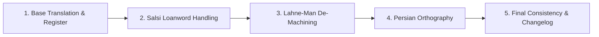

# Persian Translation Polisher (پالایشگر ترجمه و نگارش فارسی)

The **Persian Translation Polisher** is an automated post-translation quality pipeline for agents, LLMs, and developer tools. It ensures that any Persian output — whether translated from another language or drafted directly — sounds natural, culturally grounded, orthographically flawless, and technically precise, without the telltale signs of machine generation.

---

## Upstream Foundations & Acknowledgments

This skill synthesizes and enforces the principles of leading open-source Persian language and engineering projects, directly adopting their official definitions and naming:

1. **[Salsi (سالسی)](https://github.com/pooooooriya/salsi)** by Pooriya ([@pooooooriya](https://github.com/pooooooriya)): Loanword scanner and stylistic enhancer for written Persian prose based on the Pasban dictionary (over 20,071 words), featuring smart protection layers for technical terms and code, governed by the core principle *"Clarity over purity"* (وضوح بر خلوص زبانی اولویت دارد).
2. **[Lahne-Man (لحن من)](https://github.com/RezaEsmailGol/lahne-man)** by Reza EsmailGol ([@RezaEsmailGol](https://github.com/RezaEsmailGol)): Preserves the author's authentic voice and textual identity (humor, hesitation, directness, colloquialisms, technical terms) with minimal effective edits; eliminates robotic cadences, low-information empty openers («در دنیای پرشتاب امروز...», «حقیقت این است که...»), artificial triads, and inflated hype, without fabricating fresh facts, statistics, or sources; includes a non-destructive check mode.
3. **[persian-writing (نگارش فارسی حرفه‌ای برای هوش مصنوعی)](https://github.com/ali2000hos/persian-writing)** by Ali Hosseini ([@ali2000hos](https://github.com/ali2000hos)): Professional Persian (Farsi) writing and RTL documents skill for AI agents. Fixes stiff bookish machine prose, RTL layout failures, standard Persian characters (`ی/ک` instead of `ي/ك`), Persian digits, proper Zero-Width Non-Joiner (ZWNJ / نیم‌فاصله), Persian quotation marks (« »), He-Kasreh errors, and eradicates pseudo-administrative verbs like «می‌باشد».
4. **[Awesome Persian AI Rules & BiDi Standards](https://github.com/amir-hdri/awesome-persian-ai-rules)** by Amir Heydari ([@amir-hdri](https://github.com/amir-hdri)): Universal standards, typography, RTL layouts, and definitive BiDi bug resolution for all AI coding assistants and agents; eliminates character/punctuation flipping with invisible Unicode directional marks (`RLM`/`LRM`) and CSS logical properties (Start/End).

---

## When to Activate

Trigger this pipeline automatically upon encountering:
- Any prompt asking to **translate into Persian / Farsi** (e.g., "ترجمه کن به فارسی", "Translate this to Persian").
- Any request to **improve, polish, or humanize Persian text** ("لحنش رو طبیعی کن", "کمتر شبیه هوش مصنوعی باشه", "ویراستاری کن").
- Any workflow generating **Persian UI copy, button labels, notifications, onboarding flows, marketing pages, or technical documentation**.
- Any multilingual localization task targeting Iranian / Persian-speaking users.

---

## The 5-Stage Pipeline

Execute these stages sequentially. Do not skip stages.



---

### Stage 1: Base Translation & Register Alignment

Produce an accurate, idiomatically sound base translation that avoids word-for-word literalism while respecting the target register (see [references/register-modes.md](references/register-modes.md)):

1. **Detect / Select the Register:**
   - **UI / Microcopy (رابط کاربری):** Terse, action-oriented, clear. Prefer standard user-facing terms («لغو», «ذخیره», «ورود», «انصراف»).
   - **Conversational / Spoken (محاوره‌ای معیار):** Authentic colloquial spoken Persian (correct verb breakdown: «می‌ریم», «می‌خوایم», «بهشون»), avoiding clumsy slang or broken typography.
   - **Marketing / Landing Page (تبلیغاتی و لندینگ):** Persuasive, engaging, active voice, emotionally resonant without false hype.
   - **Technical / Dev Docs (مستندات فنی و مهندسی):** Exact, objective, preserving industry-standard terms of art.
   - **SEO / Blog Editorial (محتوا و وبلاگ):** Optimized H2/H3 headlines, concise meta descriptions (130-155 characters), scannable prose.
   - **Formal / Academic (کتابی و دانشگاهی):** Graceful, authoritative, balanced prose.
2. **Structure & Idioms:**
   - Deconstruct English sentence structures (SOV vs SVO). Persian places verbs at the end naturally.
   - Translate thoughts, idioms, and cultural metaphors into authentic Persian idioms (e.g., "piece of cake" ➔ «مثل آب خوردن», not «تکه‌ای کیک»).

---

### Stage 2: Salsi-Style Loanword Handling

Scan for foreign loanwords (English, French, or unnecessary Arabic borrowings) and replace them with natural, established Persian terms according to [references/loanword-dictionary.md](references/loanword-dictionary.md).

#### Core Rule: Clarity Over Purity (وضوح بر خلوص زبانی اولویت دارد)
- **Do replace** unnecessary everyday loanwords:
  - `آیتم` ➔ `مورد` / `قلم` / `گزینه`
  - `کنسل کردن` ➔ `لغو کردن` / `انصراف`
  - `آپدیت` ➔ `به‌روزرسانی`
  - `کانفیگ` ➔ `پیکربندی` / `تنظیمات`
  - `اتوماتیک` ➔ `خودکار`
  - `سیو کردن` ➔ `ذخیره کردن`
  - `شیر کردن` ➔ `هم‌رسانی کردن` / `به اشتراک گذاشتن`
  - `ارور` ➔ `خطا`
  - `یوزر` ➔ `کاربر`
  - `پسورد` ➔ `گذرواژه` / `رمز عبور`
  - `لاگین` ➔ `ورود`
  - `ساین‌آپ` ➔ `ثبت‌نام`
  - `فوکوس کردن` ➔ `تمرکز کردن`
  - `آنالیز` ➔ `تحلیل` / `بررسی`
  - `پروسه` ➔ `فرایند`
- **NEVER alter or replace:**
  - **Technical terms of art:** `API`, `token`, `compiler`, `SDK`, `webhook`, `protocol`, `algorithm`, `docker`, `container`, `git`, `commit`, `cache`, `thread`, `query`.
  - **Brand and product names:** Stripe, Google, Figma, Redis, Next.js, GitHub.
  - **Code identifiers, paths, URLs, and commands:** `src/components/`, `npm run build`, `user_id`, `apiKey`.
  - **Proper nouns, quoted text, scientific formulas, units of measurement.**
- **Banish Literal Translation Traps (پرهیز از خطاهای فاحش ترجمه تحت‌اللفظی):**
  - Never translate software concepts literally into unrelated physical domains (e.g., in software/AI, `pipeline` ➔ `فرایند`, `زنجیره پردازش`, `چرخه`, NEVER «خط لوله»! `thread` in OS ➔ `ترد/رشته`, NEVER «نخ»!).
- **If a Persian translation would cause confusion in context, retain the recognized term or loanword.**

---

### Stage 3: Lahne Man–Style De-Machining

Eliminate robotic AI fingerprints and restore human warmth and directness according to [references/lahne-man-patterns.md](references/lahne-man-patterns.md).

1. **Delete Empty Openers & Clichés:**
   - ❌ `در دنیای پرشتاب امروز...`
   - ❌ `امروزه در عصر تکنولوژی و هوش مصنوعی...`
   - ❌ `بدون شک / جای تردید نیست که...`
   - ❌ `همان‌طور که می‌دانید...`
   - *Fix:* Dive straight into the core message.
2. **Break Unnecessary Triads (سه‌گانه‌سازی‌های تصنعی):**
   - ❌ `سریع، ایمن و قابل‌اعتماد` ➔ Focus on the single most compelling differentiator.
   - ❌ `خلاقیت، نوآوری و تمایز` ➔ Use focused, concrete phrasing.
3. **Strip Hollow Hype & Exaggerations:**
   - Remove or replace: `انقلابی`, `تحول‌آفرین`, `معجزه‌آسا`, `بی‌نظیر`, `شگفت‌انگیز`, `فوق‌العاده`.
   - Replace boasting with factual descriptions.
4. **Prune Synonym Spinning & Padding:**
   - Remove redundant phrases that repeat the same concept in different words.
5. **Vary Rhythm & Suppress Unnatural Passives:**
   - Convert stiff passive constructions (`توسط تیم انجام پذیرفت`) into crisp active voice (`تیم انجام داد`).
   - Alternate between short and medium sentences.
6. **Cut Preachy Moralizing Endings:**
   - Delete hollow concluding sentences like `امید است که با به‌کارگیری این روش گامی مهم در پیشرفت بردارید.`

---

### Stage 4: Persian-Writing–Style Orthography & BiDi Engineering

Enforce rigorous Persian typography, BiDi stability, and editorial hygiene according to [references/orthography-cheat-sheet.md](references/orthography-cheat-sheet.md), [references/bidi-rtl-engineering.md](references/bidi-rtl-engineering.md), and [references/i18n-pluralization.md](references/i18n-pluralization.md).

1. **Unicode Character Normalization:**
   - Convert Arabic `ي` (`U+064A`) to Persian `ی` (`U+06CC`).
   - Convert Arabic `ك` (`U+0643`) to Persian `ک` (`U+06A9`).
   - Convert Arabic digits to Persian digits (`۰ ۱ ۲ ۳ ۴ ۵ ۶ ۷ ۸ ۹`) in prose, while keeping Latin digits in code, URLs, models, versions, and technical IDs.
2. **Enforce Correct ZWNJ (Zero-Width Non-Joiner / نیم‌فاصله):**
   - Continuous prefix: `می‌شود` (not `میشود` or `می شود`).
   - Negative continuous: `نمی‌دانم` (not `نمیدانم` or `نمی دانم`).
   - Plural suffix: `کتاب‌ها`, `سامانه‌ها` (not `کتابها` or `کتاب ها`).
   - Negative prefix `بی`: `بی‌نظیر`, `بی‌پاسخ` (not `بینظیر` or `بی نظیر`).
   - Comparative/Superlative suffixes: `بزرگ‌تر`, `بهترین`, `مهم‌ترین`.
   - Indefinite `ای` after silent heh: `خانه‌ای`, `پنجره‌ای`.
   - Compound words: `به‌روزرسانی`, `دست‌اندرکاران`, `پیش‌فرض`, `گفت‌وگو`.
3. **Eliminate He-Kasreh Errors (تفکیک هکسره):**
   - Do not write the ezafe connector (`-ِ`) as `ه`: `کتابِ من` (or `کتاب من`), never `کتابه من`.
   - Ensure true final heh is not dropped: `دیده`, `آمده`.
4. **BiDi & RTL Punctuation Stability:**
   - Punctuation marks (`.` `،` `؛` `:` `!` `؟`) must adhere directly to the preceding word without a space, followed by a single space.
   - Prevent punctuation flipping at line endings with mixed English/codes using the Unicode Right-to-Left Mark (`\u200F` / RLM) when necessary.
   - Always wrap English words, code identifiers, and file paths in inline code backticks or Persian quotes (« »).
   - Use Persian quotation marks (« ») instead of English quotes (`" "`).
5. **Persian Pluralization & i18n Variables:**
   - Nouns following numbers are always singular in Persian: `۵ کاربر` (never `۵ کاربران`), `۱۰ فایل` (never `۱۰ فایل‌ها`).
   - Never translate variable placeholders (e.g. `{count}`, `{username}`).
6. **Eradicate Bureaucratic Clutter:**
   - Replace `می‌باشد` / `نمی‌باشد` with `است` / `هست` / `نیست`.
   - Replace `لازم به ذکر است که` with direct statements or `باید گفت` / `یادآوری می‌شود`.
   - Replace `نسبت به انجام آن اقدام نمایید` with `آن را انجام دهید`.
   - Replace `مورد استفاده قرار می‌گیرد` with `استفاده می‌شود` or `به کار می‌رود`.

---

### Stage 5: Final Pass & Structured Output

1. **Modes of Operation:**
   - **Default Mode (Polish & Rewrite):** Runs the full 5-stage pipeline, outputting the polished text and the changelog.
   - **Diagnostic / Check-Only Mode:** Triggered when the user asks to "check", "review", or "audit" without editing (`فقط بررسی کن` یا `ایرادات را بگو`). Evaluates loanwords, machine tells, and orthography issues, providing a diagnostic checklist without rewriting the text.

2. **Verification Checklist:**
   - [ ] Terminology is 100% consistent throughout the text.
   - [ ] No leftover untranslated English words that should have been Persian.
   - [ ] No over-translated technical terms (e.g., leaving `API` or `Commit` intact).
   - [ ] Nouns after numbers are strictly singular (`۵ کاربر`).
   - [ ] Markdown links, code fences, inline backticks, and formatting are completely undamaged.
   - [ ] Tone is natural, authentic, and matches the target medium.

3. **Required Deliverable Output Format:**
   Always deliver your output in two parts:

   ```markdown
   ### متن صیقل‌خورده (Polished Output)
   [The complete, polished Persian text here]

   ---

   ### تغییرات اصلی (Changelog)
   - **اصلاح اصطلاحات:** [جایگزینی وام‌واژه‌های انگلیسی با برابرهای مصطلح، مانند X ➔ Y]
   - **حذف ردپای هوش مصنوعی:** [حذف مقدمه کلیشه‌ای / سه‌گانه‌سازی / واژگان اغراق‌آمیز]
   - **دستور خط و نیم‌فاصله:** [اصلاح نیم‌فاصله‌ها، تبدیل ی/ک عربی، یا اصلاح هکسره]
   - **ساده‌سازی و روان‌سازی:** [حذف «می‌باشد»، اصلاح مجهول‌ها به معلوم، یکدستی لحن]
   ```
   *(Keep the changelog between 3 to 8 concise, specific bullet points).*

---

## Strict Constraints

- **Integrity of Markdown & Code:** Never break code blocks, inline code, URLs, query parameters, HTML tags, or markdown structure.
- **No Hallucination:** Never fabricate statistics, quotes, technical parameters, or claims absent from the original source.
- **Minimal Effective Edits:** When refining existing Persian text, prefer precise surgical improvements over unnecessary full rewrites.
- **Domain Sensitivity:**
  - *Developer Documentation:* Prioritize technical precision; preserve standard industry jargon in English or standard transliteration.
  - *Consumer / Product / Web:* Prioritize Persian fluency, warmth, accessibility, and frictionless RTL reading.

---

## Reference Examples

### Example 1: UI / Web Copy

**Original Machine Output:**
> به منظور آپدیت نمودن پروفایل کاربری خود بر روی دکمه ادیت کلیک نمایید. لازم به ذکر است که پسورد شما دارای امنیت بالایی میباشد و به صورت اتوماتیک سیو میگردد.

**Polished with Pipeline:**
> برای به‌روزرسانی حساب کاربری خود، روی «ویرایش» بزنید. رمز عبور شما امنیت بالایی دارد و خودکار ذخیره می‌شود.

**Key Changes:**
- `آپدیت نمودن` ➔ `به‌روزرسانی` (سالسی + حذف فعل اداری)
- `کلیک نمایید` ➔ `بزنید` (مناسب رابط کاربری فارسی)
- `لازم به ذکر است که` ➔ حذف مقدمه غیرلازم (لحن من)
- `میباشد` ➔ `دارد` (دستور خط و ساده‌نویسی)
- `اتوماتیک سیو میگردد` ➔ `خودکار ذخیره می‌شود` (وام‌واژه‌زدایی و تصحیح نیم‌فاصله)

---

### Example 2: Marketing Copy

**Original Machine Output:**
> در دنیای پرشتاب امروز، ابزار انقلابی ما راهکاری سریع، آسان و شگفت‌انگیز برای مدیریت کارهای شما می‌باشد که نوآوری، خلاقیت و تمایز را به ارمغان می‌آورد.

**Polished with Pipeline:**
> این ابزار به شما کمک می‌کند کارهایتان را ساده‌تر و سریع‌تر مدیریت کنید و بر نتیجه متمرکز بمانید.

**Key Changes:**
- حذف مقدمه کلیشه‌ای «در دنیای پرشتاب امروز»
- حذف واژگان اغراق‌آمیز «انقلابی»، «شگفت‌انگیز»
- شکستن سه‌گانه‌سازی تصنعی «سریع، آسان و شگفت‌انگیز» و «نوآوری، خلاقیت و تمایز»
- جایگزینی فعل اداری «می‌باشد» با ساختار روان و طبیعی
- اعمال نیم‌فاصله در «کارهایتان» و «ساده‌تر»

---

### Example 3: Technical / Engineering Documentation

**Original Machine Output:**
> برای ارتباط با ای‌پی‌آی، ابتدا توکن را در هدر ریکوئست کانفیگ کنید. دیتای برگشتی به فرمت جیسون میباشد.

**Polished with Pipeline:**
> برای ارتباط با API، ابتدا توکن را در هدر درخواست (Request Header) تنظیم کنید. داده‌های دریافتی با قالب JSON بازگردانده می‌شوند.

**Key Changes:**
- حفظ اصطلاحات فنی استاندارد (`API`, `JSON`, `توکن`)
- تبدیل `ریکوئست` به `درخواست` (با حفظ اصطلاح فنی در صورت نیاز)
- تبدیل `کانفیگ کنید` به `تنظیم کنید`
- تبدیل `دیتای برگشتی` به `داده‌های دریافتی`
- حذف `میباشد` و جایگزینی با فعل ساختارمند فارسی

---

### Example 4: UI Microcopy & i18n Pluralization

**Original Machine Output:**
> شما تعداد 5 آیتم‌ها را انتخاب نمودید. آیا می‌خواهید آنها را Delete کنید؟ برای راهنمایی بیشتر به docs/api.md مراجعه فرمایید:

**Polished with Pipeline:**
> ۵ مورد را انتخاب کرده‌اید. می‌خواهید آن‌ها را حذف کنید؟ برای راهنمایی بیشتر، مستندات `docs/api.md` را ببینید:

**Key Changes:**
- اصلاح قاعده شمارش در زبان فارسی: `۵ مورد` به جای `تعداد 5 آیتم‌ها`
- تبدیل وام‌واژه `Delete` به معادل طبیعی `حذف کنید`
- حذف ساختار اداری `انتخاب نمودید` و `مراجعه فرمایید`
- قرار دادن مسیر فایل در کد درون‌خطی (`docs/api.md`) جهت جلوگیری از به هم ریختن جهت راست‌به‌چپ (BiDi)
- تبدیل ارقام انگلیسی به فارسی در متن رابط کاربری (`5` ➔ `۵`)
